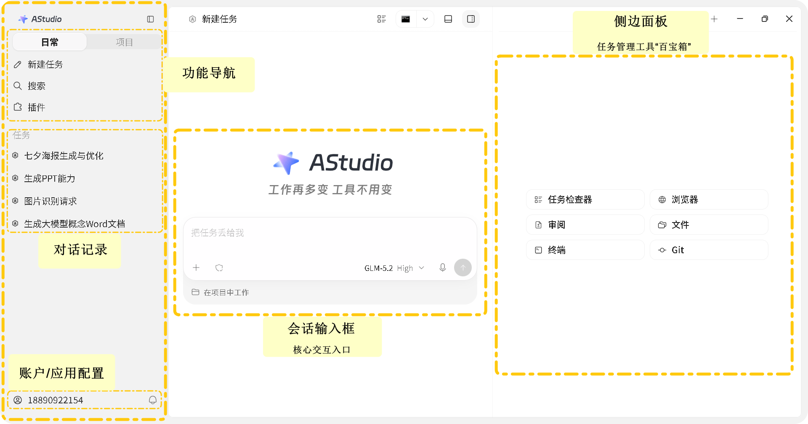
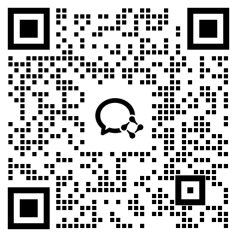

<p align="center">
  
</p>

# Astron Harness Tutorial

**AStudio → Loomy → AstronClaw。** 从完成一个任务开始，学习如何交付真实成果，再建立适合自己的 AI 工作流。

[在线阅读](https://astronclaw-tutorial.space/) · [从 AStudio 开始](docs/guide/astudio/quickstart.md) · [English](README_EN.md)

<p align="center">
  <a href="https://github.com/iflytek/astron-harness-tutorial/actions/workflows/deploy.yml"></a>
  <a href="LICENSE"></a>
</p>



## 找到适合你的起点

| 产品 | 适合从什么需求开始 | 学习入口 |
| --- | --- | --- |
| **01 · AStudio** | 围绕目标推进任务并交付成果 | [工作台指南](docs/guide/astudio/intro.md) · [快速上手](docs/guide/astudio/quickstart.md) |
| **02 · Loomy** | 本地资料与日常办公协作 | [桌面搭子指南](docs/guide/loomy/introduction.md) · [快速开始](docs/guide/loomy/quick-start.md) |
| **03 · AstronClaw** | 云端任务与消息渠道协作 | [云端助手指南](docs/guide/astronclaw/introduction.md) · [开始使用](docs/guide/astronclaw/getting-started.md) |

## 01 · AStudio：从目标走向成果

先认识工作区并完成第一个任务，再学习项目、规划与目标模式、预览编辑、权限、自动化和插件。教程配有 **56 张保存到本地的官方图片**，中英文页面均可按步骤对照操作。

- [核心功能](docs/guide/astudio/features.md)：选择工作模式，检查执行过程与结果。
- [实践案例](docs/guide/astudio/cases.md)与[使用技巧](docs/guide/astudio/tips.md)：练习调研、建站与持续迭代。
- [套餐与积分](docs/guide/astudio/pricing.md)、[常见问题](docs/guide/astudio/faq.md)和[隐私政策](docs/guide/astudio/agreements/privacy-client.md)：使用前了解规则。

## 02 · Loomy：融入日常的桌面搭子

连接本地文件、资料库与办公工具，学习[AI 搭子](docs/guide/loomy/companions.md)、[工具箱](docs/guide/loomy/toolbox.md)、[典型场景](docs/guide/loomy/scenarios.md)，并[构建个人搭子](docs/guide/loomy/personal-companion.md)。

## 03 · AstronClaw：让任务在云端继续

从托管助手快速开始，接入[技能](docs/guide/astronclaw/skills.md)与[消息渠道](docs/guide/astronclaw/channels.md)，结合[场景](docs/guide/astronclaw/scenarios.md)和[计费规则](docs/guide/astronclaw/billing.md)设计自己的工作方式。

## 文档与配图如何更新

每日巡检按 AStudio、Loomy、AstronClaw 检查官方资料。AStudio 覆盖全部 15 个指南与协议页面，并检查图片内容；新增图片和同地址替换图片都会报告，供人工核对。详见[巡检说明](scripts/doc-watch/README.md)与[图片来源清单](docs/public/astudio/README.md)。

截图保留官方中文界面，英文教程附英文图注。教程站支持点击图片放大。

## 本地开发与预览

本项目基于 [VitePress](https://vitepress.dev/) 构建。如果你想在本地预览或修改文档：

```bash
# 1. 克隆仓库
git clone https://github.com/iflytek/astron-harness-tutorial.git
cd astron-harness-tutorial

# 2. 安装依赖
npm install

# 3. 启动本地预览服务
npm run docs:dev

# 4. 构建静态文件
npm run docs:build
```

### 学习助手模型配置

学习助手使用 **Spark-X2.6-4B**，支持流式回答和中英文页面。将 `.env.example` 复制为 `.env`，填写已开通 Spark-X2.6-4B 权限的 `ASTRON_MAAS_API_KEY`；密钥只在服务端使用，不要放入 `VITE_` 开头的变量。

默认模型为 `spark-x2.6-4b`，接口为 `https://maas-api.cn-huabei-1.xf-yun.com/v2/chat/completions`，思考强度为 `low`。如需调整，可配置 `.env.example` 中的服务端变量。旧客户端传入的模型名不会覆盖服务端配置。

本地使用学习助手时，在一个终端运行 `npm run server`，另一个终端运行 `npm run docs:dev`。Vercel 部署需要配置同名环境变量并重新部署。可运行 `npm run test:chat` 进行无外部调用的回归测试，或运行 `node test-api.js` 验证实际模型连接。

## 贡献与反馈

欢迎提交 Issue 和 PR！让我们一起把它打磨得更好，帮助更多人让 AI 真正进入日常工作流。

在提交 PR 之前，请阅读我们的 [贡献指南](CONTRIBUTING.md)。首次贡献时，CLA Assistant 机器人会自动在您的 PR 下方留言，引导您完成贡献者许可协议 (CLA) 的签署。

## 一起交流学习

| AStudio | Loomy | AstronClaw |
| :---: | :---: | :---: |
|  |  |  |

[AStudio 飞书交流群](docs/public/astudio/images/feishu-group-qr-20260902.png) · [Astron 开源交流群](https://github.com/iflytek/astron-agent/raw/main/docs/imgs/WeCom_Group.png)

## 开源协议

教程源码采用 [Apache License 2.0](LICENSE)。官方产品图片与标识的权利归其各自权利人所有，详见[素材说明](docs/public/astudio/README.md)。
